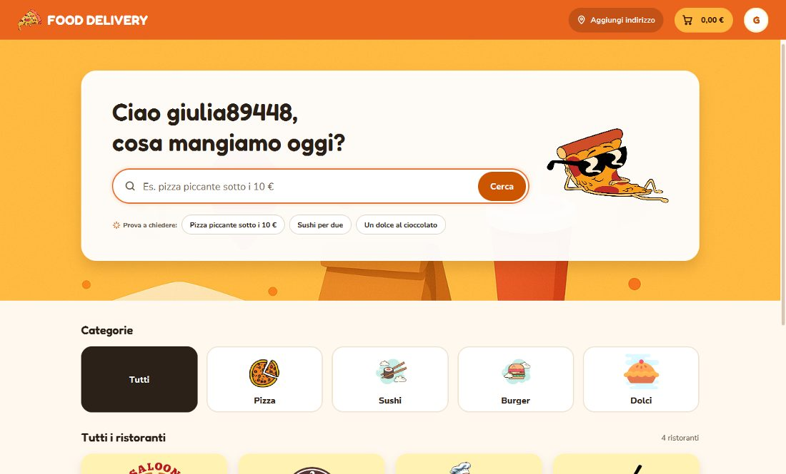
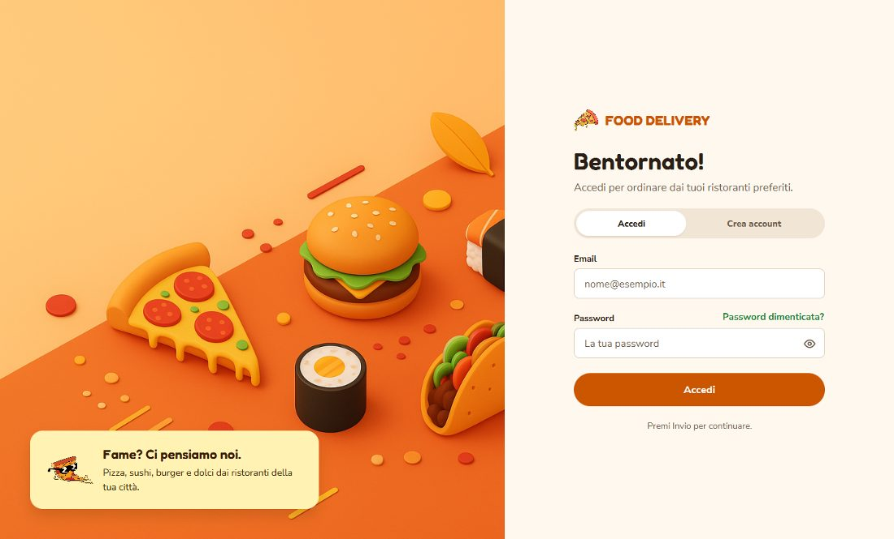
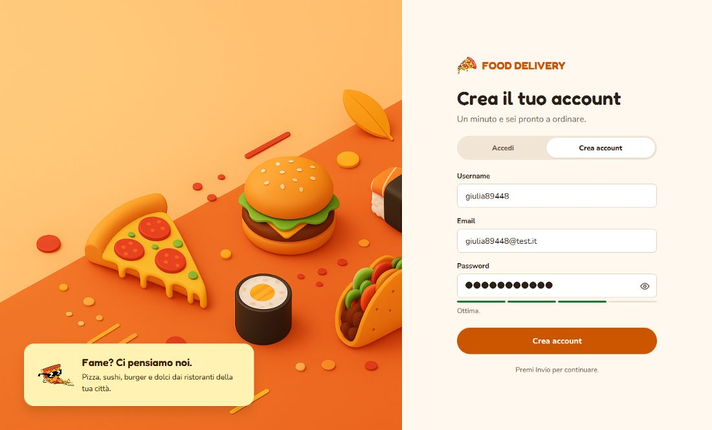
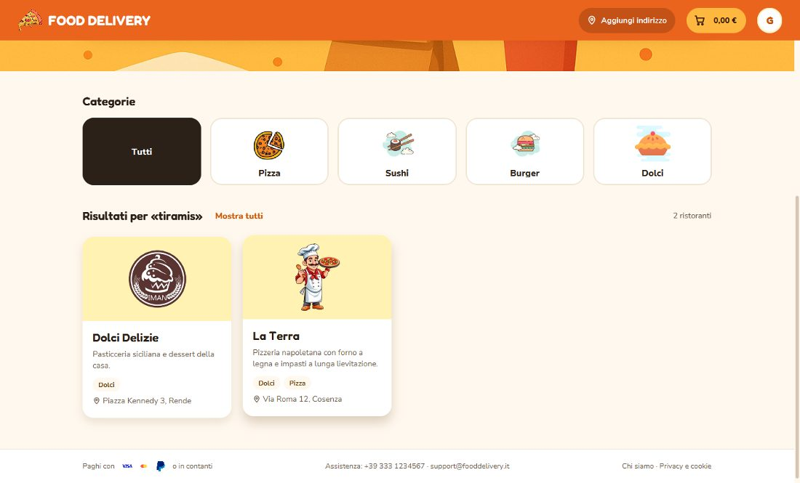
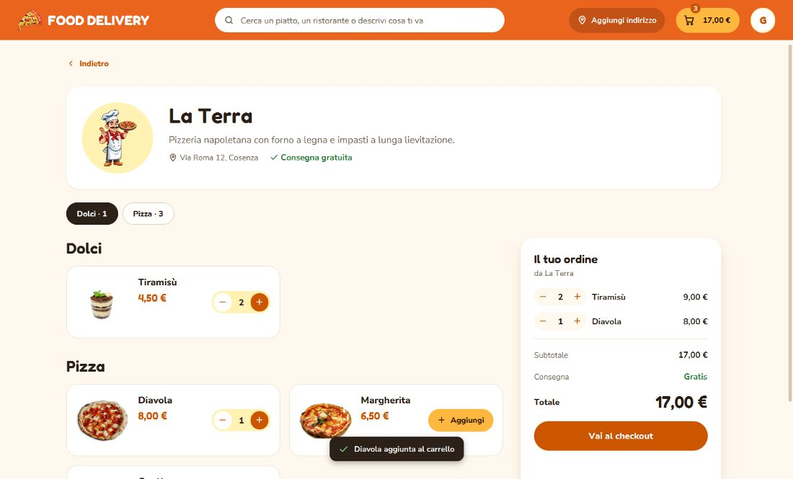
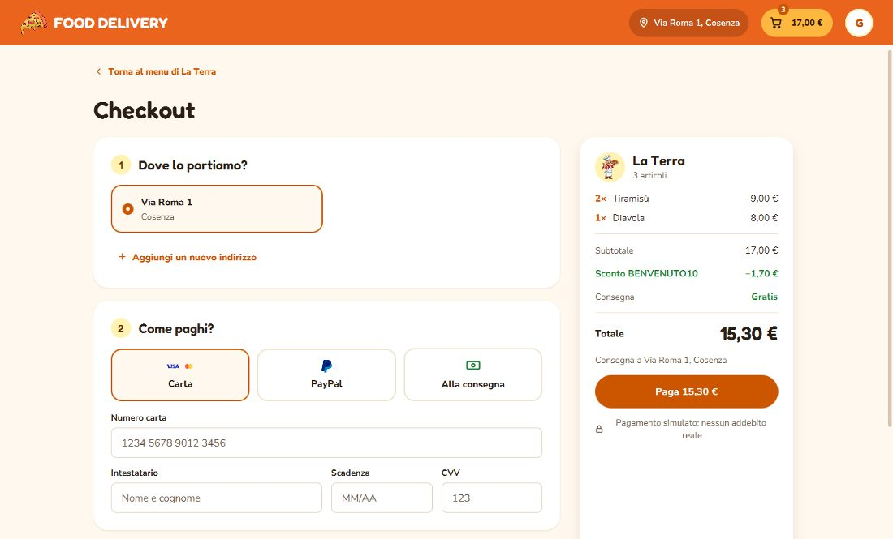
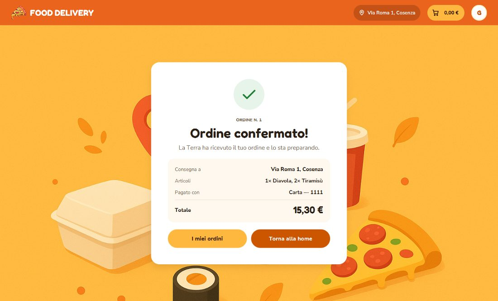
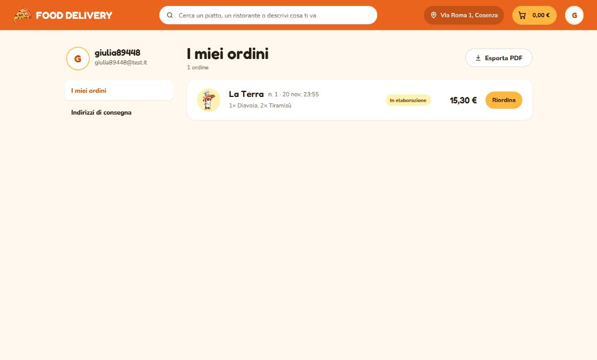
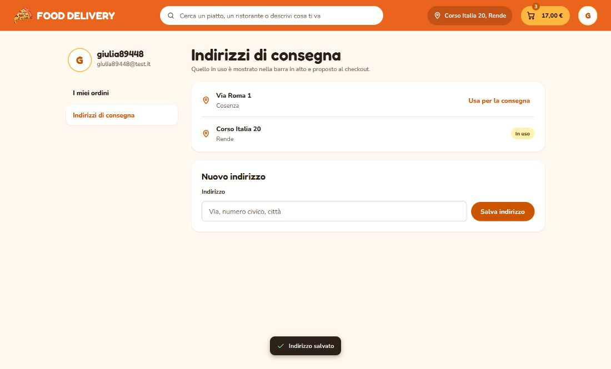
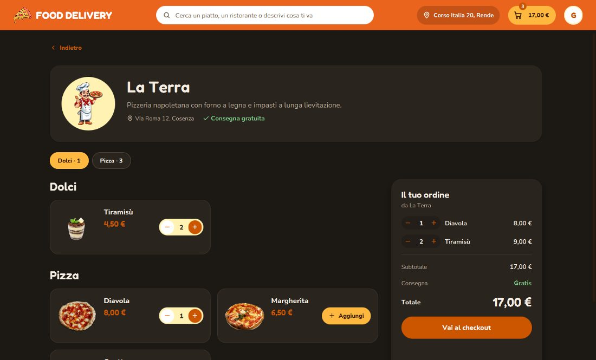

<div align="center">
  
# 🍔 FoodDelivery App
**Applicazione Desktop JavaFX per la gestione di ordini a domicilio con integrazione di Intelligenza Artificiale.**

[]()
[]()
[]()
[]()

---

Un'applicazione gestionale per ordini di ristorazione a domicilio, progettata utilizzando architetture software robuste (MVC, DAO, Service Layer) e dotata di un "Assistente AI" integrato in grado di convertire le richieste naturali in query SQL dinamiche.

</div>


<br />



## 🚀 Caratteristiche

- **Design system v2** progettato su tela e implementato 1:1: token CSS, font inclusi, icone vettoriali, tema chiaro e scuro. Vedi [docs/DESIGN.md](docs/DESIGN.md).
- **Ricerca intelligente**: con una chiave OpenAI la richiesta in linguaggio naturale diventa una query; la SQL generata viene accettata solo se è una singola `SELECT`. Senza chiave c'è la ricerca testuale.
- **Ordine in 4 passaggi**: home → ristorante (carrello sempre visibile) → checkout con pagamento → conferma.
- **Ordini transazionali** (`OrderService`): ordine e dettagli in un'unica transazione.
- **Area account**: storico ordini con riordino ed export PDF, gestione indirizzi.

| | | |
|---|---|---|
|  |  |  |
|  |  |  |
|  |  |  |

## 🛠️ Stack

Java 21 · JavaFX 21 · MySQL 8 · OpenAI API (facoltativa) · iText 5 (PDF) · org.json · font Fredoka e Nunito Sans (OFL)

## ▶️ Avvio

1. **Database**: `mysql -u root -p < database/schema.sql` (crea `fooddelivery` con dati demo e il coupon `BENVENUTO10`).
2. **Configurazione**: copia `src/config.example.properties` in `src/config.properties` e inserisci le credenziali (il file è ignorato da git).
3. **Dipendenze**: JavaFX SDK 21, MySQL Connector/J, e i jar in `src/libs/`.
4. **Esecuzione** (IntelliJ: main class `app.Main`, VM options):
   ```
   --module-path <percorso>/javafx-sdk-21/lib --add-modules javafx.controls,javafx.fxml
   ```
   Dalla schermata di accesso scegli "Crea account".

## 📦 Struttura

```plaintext
src/
 ├ app/         Main (carica i font) e Navigator (scena unica, shell, cronologia)
 ├ controller/  Shell (app bar) + una classe per schermata: Auth, Home, Restaurant, Checkout, Confirmation, Account
 ├ ui/          componenti: Icons (SVG), PasswordInput, stepper, card, stati vuoti, dialog
 ├ model/       Cart (sessione d'ordine osservabile, un ristorante per carrello), User, Restaurant, MenuItem, Order
 ├ dao/         accesso ai dati (una classe per tabella) + Db
 ├ service/     OrderService (ordine transazionale)
 ├ ai/          AIAgent (OpenAI → SQL)
 ├ util/        Config, Passwords, Validators, Fmt, Images
 ├ view/        FXML: shell + una vista per schermata
 ├ css/         app.css (design system) e dark.css (tema scuro)
 ├ fonts/       Fredoka, Nunito Sans + licenze OFL
 └ img/         immagini
database/schema.sql   schema e dati demo
docs/DESIGN.md        token, componenti, flusso e decisioni UX
```

Self-check senza framework: `java -ea -cp <classi> util.Validators`, `dao.RestaurantDAO`, `controller.AuthController`.
